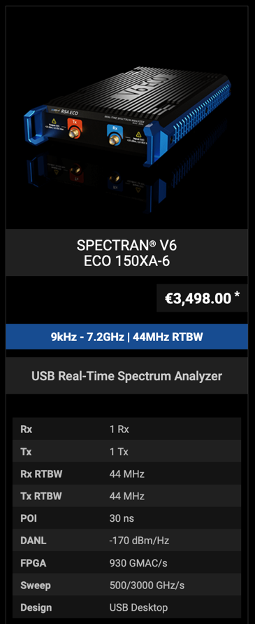
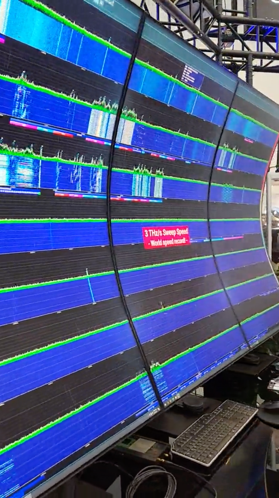
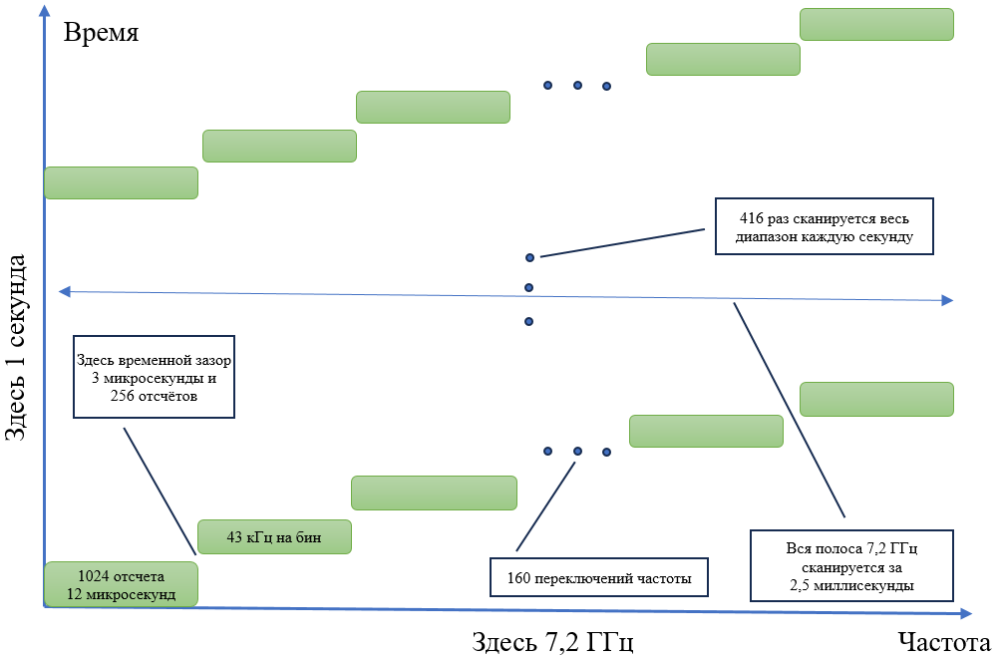

> автор: Виктор Смирнов aka Newbie

# Арифметика спектроанализатора или «Я сам обманываться рад»

## Предисловие

Предыстория этой статьи началась задолго до голосования в чате FPGA-Systems об интересе участников к этой теме. Немногим более 20 лет назад в немецком городе Ойшайд Торстеном Чмилусом была основана компания Aaronia AG, которая выбрала себе слоган «Измеряя невидимое». Под этим самым невидимым подразумеваются радиосигналы и компания изначально сосредотачивалась на различном измерительном оборудовании, в частности спектронализаторах. С 2008 года компания развивает линейку устройств под общим наименованием Spectran. Приглядимся подробнее ко всему классу таких устройств на их примере.

## Спектроанализатор

Это сейчас нас разбаловали всякие осциллографы типа Rigol’a, у которых функция спектроанализатора не только встроенная и бесплатная, но и даже программная. Да, специалисты более опытные сразу же усмехнутся, разве 100-200-300 МГц – это спектроанализатор? А вот начинающим инженерам показывают здоровенную и тяжеленную коробку по цене хорошей квартиры и никто не объясняет в чём именно разница, типа сами поймут.

Каких-то десять-пятнадцать лет назад это был отдельный класс серьезнейших устройств со своей иерархией и только именитые мировые компании с лучшими лабораториями могли себе позволить их разработку. А в данном случае мировому рынку подобной измериловки являют по его меркам чуть ли не бесплатное чудо в виде маленькой коробочки с выдающимися заявленными параметрами. Интригует? Нас - да. 
Знакомимся. Aaronia Spectran V6 ECO 150XA-6. Действительно небольшая коробочка. Заявленная полоса одновременного обзора сигнала (RealTime BandWidth, RTBW) - 44 МегаГерца. Опытным специалистам тут же бросается в глаза непривычно высокая скорость сканирования (Sweep) – 500 или 3000 ГигаГерц в секунду. Непривычно много(быстро) – и сразу же куча вопросов:
- не ошибка ли?
- как смогли?
- за счет чего?
Вот и нам стало интересно.

Берем картинку из рекламного ролика компании с одной из выставок, который размещен в одной из социальных сетей. Вот он спектр, почти 8 ГигаГерц, вон они 3 ТераГерца в секунду. Всё живенько крутится, без рывков и лагов. На выставке можно было подойти вживую, подергать мышкой, поменять масштабы отображения и скорости, достать свой телефон/ноутбук и действительно увидеть изменения от их сигналов Wi-Fi, Bluetooth и сотового.

Значит, что оно, как минимум, не показывает ранее записанный видеоролик на экранах как это делают некоторые недобросовестные компании, уж не будем показывать пальцем.

Но 3 ТераГерца сканирования – всё-равно многовато, они не дают нам покоя, мы буквально вынуждены включить режим всезнайки-зануды и полезть проверять скупые и чопорные цифры. А цифр-то как раз и не так много – общая полоса того самого обзора 7,2 ГГц, полоса одновременного обзора 44 МГц, да скорость сканирования 3 ТГц. Всё. Больше ничего, считай, и нет.

## Безжалостная арифметика

Мы вынуждены начать с самых простых операций – соотношений этих цифр друг с другом (ну и небольших округлений в 3-5 значащих разрядах). Сначала текст с расчётами, а кому неинтересно – могут сразу переходить к следующему разделу, где будет наглядная схема с итоговыми цифрами. Поехали.

Делим 7,2 ГГц (заявленную полную полосу сканирования) на 44 МГц (заявленную полосу одновременного обзора), получаются безразмерные 163 с копейками. То есть, на пальцах, чтобы просканировать весь заявленный диапазон этой коробочке нужно переключиться по частоте ~160 раз.

Теперь делим 3 ТГц/с (заявленную скорость сканирования) на 7,2 ГГц (полосу сканирования), получается ~416 раз в секунду. Таким образом, вся полоса 7 ГГц каждую секунду сканируется 416 раз и это дает нам около 2,5 миллисекунд на каждый полный обзор всей полосы.
Теперь делим 3 ТГц/с на 44 МГц, получается ~68181 раз в секунду. Вот именно столько раз каждую секунду происходит переключение частоты, та самая Sweep Frequency. И соответственно ~14,5 микросекунд происходит полный цикл перестройки частоты и сбора данных в той самой полосе 44 МГц одновременного обзора.

Теперь берем нашу полосу одновременного обзора 44 МГц и умножаем ее на 2 чтобы получить 88 МГц частоты дискретизации по теореме Котельникова (Найквиста). Вот здесь тонкий момент, где-то происходит округление на уровне 3-5 знака, здесь не бывает истинно прямоугольных фильтров а-ля brickwall и на практике нужен небольшой запас чтобы соотношение полосы и тактовой частоты не было в точности равно 2. Делаем пометку на манжетах, пропускаем и идем дальше.

Теперь полученные 88 МГц тактовой частоты дискретизации делим на 68181 раз переключений в секунду. И получаем, что на каждое такое переключение приходится приблизительно 1290 отсчётов. Но для преобразования Фурье всё-таки нужна степень двойки, а поэтому выбираем ближайшее меньшее число 1024 отсчёта. Таким образом у нас получается 1024 отсчёта для работы с собственно радиосигналом в этой полосе одновременного обзора 44 МГц и запас в 1290-1024 = 266 отсчётов на глитч, всякие переключательные эффекты и устаканивание амплитуды с фазой при переключении частоты. Эти же 266 отсчётов делим на 88 МГц тактовой и получаем что-то порядка 3 микросекунд на переключение гетеродина. Ну очень ненапряжный режим.

Далее вот те 44 МГц делим на 1024 отсчёта и получаем спектральное разрешение нашего спектроанализатора порядка 43 килоГерц на единичный спектральный отсчёт.

Теперь у нас все нужные цифры чтобы нарисовать схему.

*Логика сбора данных*

На картинке прямоугольниками зеленого цвета показана та самая полоса одновременного обзора и лоскутное одеяло переключений ее во времени по частотному диапазону. Железка последовательно переключается по всему доступному частотному диапазону своими шагами по 44 МГц. Её временное и частотное разрешение составляет 12 мкс и 44 кГц. Любой сигнал меньше по полосе, чем эти 44 кГц получает визуальное ослабление яркости прямо пропорционально соотношению его полосы к этим 44 кГц, т.е. такой быстрый сканер предназначен для наблюдения сравнительно широкополосных сигналов. Любой сигнал короче 12 мкс по времени получает визуальное ослабление яркости пропорционально соотношению его длительности к этим 12 мкс. Любой сигнал короче 2,5 миллисекунд по времени получает визуальное ослабление яркости пропорционально вероятности пересечения его во времени с 12 микросекундным интервалом наблюдения полосой одновременного обзора.

Очень неочевидной фишкой сопряжения этой железки с компьютером архитектуры х86 практически наверняка является изумительная оптимизация программных вычислений преобразования Фурье. Общий блок одиночной полосы обзора в 1024 отсчета по 4 байта каждый прекрасно помещаются в кеш L1 современного процессора, это позволяет выполнять расчет преобразования Фурье на полной тактовой частоте ядер и осуществлять операции с данными при минимальных задержках в получении данных из памяти. 

## «Я сам обманываться рад»

Теперь с этой же логикой можно присмотреться и к отображению картинки на мониторах. Для упрощения будем считать разрешение мониторов 4k в 4000 столбцов пикселей на 2000 строк пикселей (там немного элементов интерфейса управления). Три монитора дают общее поле изображения размером 4 на 6 тысяч пикселей, всего около 12 млн. пикс.

По изображению в видеоролике хорошо видно 7 горизонтальных полос и естественно получается, что каждая из них имеет частотную полосу приблизительно в 1 ГГц. Таким образом на 1 пиксель изображения приходится полоса приблизительно в ~166 кГц и для расчета его яркости усредняются 4 отсчета преобразования Фурье из предыдущего раздела.

Эти же 7 горизонтальных полос, но уже по вертикали дают по ~300 пикселей для отображения спектрограммы сигнала во временной области. Скорость прокрутки на глаз порядка 1 секунды и это даёт временное разрешение картинки около 3 миллисекунд, что сопоставимо со временем сканирования всего диапазона. При таких параметрах программно отображается в яркость пикселей любое ближайшее сканирование полосы частот, приходящихся на эти пиксели, соответствующего по времени перестроения полосы одновременного обзора. Мы со всей уверенностью полагаем, что усреднение яркости пикселей на вот те отсутствующие во времени измерения сигнала у них не осуществляются. То есть программа визуализации фактически сглаживает вот то лоскутное одеяло быстрых и частых переключений по всему диапазону частот в единую слитную картинку.

Ну и поверх этого всего частота развертки самих мониторов, предоставим читателям возможность потренироваться в этой арифметике самостоятельно.

## Выводы накоротке

Временное и частотное разрешение спектроанализаторов с описанной логикой функционирования практически полностью определяются частотой дискретизации (полосой одновременного обзора), а также задержкой времени на устаканивание переключательных искажений при переключении центральной частоты обзора (гетеродина).

Отображение на мониторах получаемых данных осуществляется как правило на 2-5 порядков медленнее реальной частоты сканирования и легко интерполируется в гладкую картинку несмотря на разрывы в исходных данных.

Программное обеспечение выполнено с использованием фреймворка QT6 и изначально спроектировано по модульному принципу для дальнейшего наращивания функций только программным методом без переработки прошивки ПЛИС.

Ну и естественно визуальное наблюдение 12 мегапикселей картинки со скоростью развертки в 1 секунду для любого разумного человека вызовет очень быструю перегрузку зрительных рецепторов и такой режим используется на выставке для создания Вау-фактора.
Хайп как он есть. Умеют, могут, практикуют.

Спасибо за Ваше внимание!
